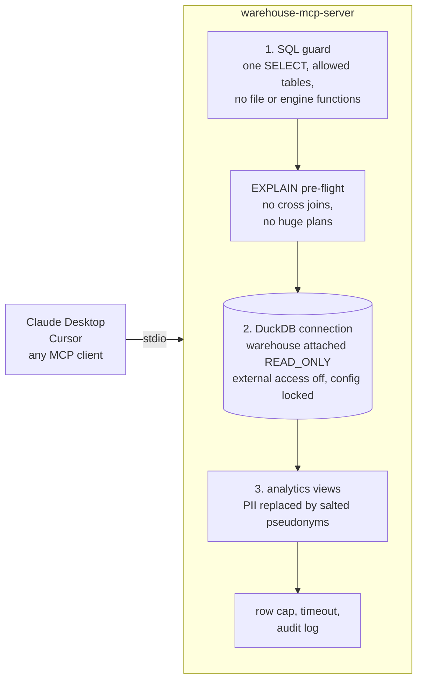

# warehouse-mcp-server

A read-only [MCP](https://modelcontextprotocol.io) server that lets Claude, Cursor or any MCP client answer business questions from a SQL warehouse, without being able to write, read files, see personal data, or run a query that takes the warehouse down.

It is the fourth piece of a small end-to-end data platform for a fictional online coffee shop. It serves the marts built by [dbt-ecommerce-warehouse](https://github.com/markotalledo/dbt-ecommerce-warehouse).


The recording is a real MCP client talking to the server over stdio, the same way Claude Desktop does. Reproduce it with `uv run python examples/demo.py`, or re-record it with `vhs docs/demo.tape`.



## What a client can do

| Tool | Returns |
|---|---|
| `list_tables` | Tables with row counts and the descriptions written in dbt |
| `describe_table` | Columns with type, dbt description, and whether the column is pseudonymized PII |
| `run_query` | Rows of one SELECT, capped, with a `truncated` flag |

All three are annotated read-only and idempotent. Rejections come back as data (`{"error": ..., "reason": ...}`), so the model can read why and fix its query.

## Quickstart

```bash
make setup    # uv sync
make test     # 38 tests: 27 security cases, PII, caps, timeout, audit, stdio server
make serve    # runs the server on stdio
```

To use it from Claude Desktop, add this to `claude_desktop_config.json`:

```json
{
  "mcpServers": {
    "warehouse": {
      "command": "uv",
      "args": ["--directory", "/path/to/warehouse-mcp-server", "run", "warehouse-mcp"],
      "env": { "MCP_PII_SALT": "change-me" }
    }
  }
}
```

## Defense in depth

Three layers, each enforced without trusting the one before it.

1. **The SQL guard** parses the query with sqlglot and accepts exactly one SELECT (CTEs and unions included) over the tables `list_tables` returns. It rejects writes and DDL, stacked statements, `COPY`, `ATTACH`, `SET`, `PRAGMA`, `SELECT INTO`, and table functions that read files or engine state (`read_*`, `glob`, `getenv`, `duckdb_*`).
2. **The connection** attaches the warehouse file `READ_ONLY`, then turns off external access and locks the configuration. A query that got past the guard still cannot read a file, reach the network, or turn either back on. There is a test that skips the guard and tries.
3. **The data** the connection can see is a set of views where `customer_id` and `anonymous_id` are replaced by `anon_` plus a salted SHA-256. The same customer gets the same pseudonym in every table, so joins still work, but raw identifiers are not reachable from SQL. The salt lives in the server process, not in the view definitions.

Then, before running: an **EXPLAIN pre-flight** rejects cross joins and plans estimated above 5 million rows. While running: a **timer interrupts** queries after 10 seconds. After: results are **capped** (50 rows by default, 500 max) and every call is written to a JSONL **audit log** with the SQL, outcome, rejection reason, row count and latency.

## Threat model

| Threat | Stopped by | Test |
|---|---|---|
| The model writes or deletes data | Guard accepts only SELECT; warehouse attached read-only | `test_security_case[drop]`, `test_raw_tables_are_read_only` |
| Prompt injection makes the model read local files or secrets | Guard denies file and env functions; external access disabled and locked | `test_security_case[read a file]`, `test_connection_blocks_files_even_if_the_guard_is_bypassed` |
| Personal data ends up in a chat transcript | Only pseudonymized views are queryable | `test_raw_pii_never_leaves_the_server` |
| Pseudonyms reversed by hashing every known id | Salted hash, salt kept out of SQL | `test_salt_changes_pseudonyms` |
| A runaway query saturates the warehouse | EXPLAIN pre-flight, timeout, row cap | `test_security_case[cross join]`, `[huge plan]`, `test_slow_queries_are_interrupted` |
| Nobody can tell what the model asked | Audit log of every call, allowed or not | `test_every_call_is_audited` |

Every case in `evals/security_cases.yaml` runs in CI on every push.

## Answer quality eval

`evals/questions.yaml` has 10 business questions, each with a reference SQL query. `evals/run_llm_eval.py` gives Claude the same three tools, lets it explore and query, asks for a final `ANSWER:` line, and scores it against the reference. It reports accuracy, tool calls and cost.

```bash
make eval-dry   # reference answers only, no API calls
make eval       # runs Claude (needs Anthropic credentials, about a dollar per run)
```

The questions are the kind a business user asks: revenue, average order value, conversion by platform, repeat customers, revenue share by payment method, top category by units. Two of them have a trap: one needs the cents-to-dollars conversion, and the last one asks for a customer id, which can only be answered with a pseudonym.

## Design decisions

- **DuckDB in front, not just the guard.** Parsing SQL to decide what is safe is a moving target. The guard catches the obvious and gives the model a clear reason; the read-only attach, the locked configuration and the views are what actually make it safe.
- **Pseudonymize, do not drop.** Removing `customer_id` would break the questions people actually ask ("how many customers ordered twice"). A stable pseudonym keeps them answerable without exposing anyone.
- **Docs come from dbt.** Table and column descriptions are the ones written in the dbt project, so the model reads the same definitions analysts do and there is one place to fix them.
- **Errors are answers.** A rejected query returns its reason to the model instead of failing the tool call, so it can rewrite the query instead of giving up.

## Configuration

| Variable | Default | Purpose |
|---|---|---|
| `WAREHOUSE_DB` | `fixtures/warehouse.duckdb` | DuckDB file with the marts |
| `WAREHOUSE_SOURCE_SCHEMA` | `marts` | Schema to expose |
| `WAREHOUSE_CATALOG` | `fixtures/catalog.json` | Table and column descriptions extracted from dbt |
| `MCP_PII_SALT` | random per process | Set it, or pseudonyms change on every restart |
| `MCP_AUDIT_LOG` | `audit.log` | Where the audit trail goes |

To serve Snowflake, Redshift or Postgres instead of a DuckDB file, the same three layers apply with the warehouse's own tools: a role with only `SELECT` on a schema of masked views, a statement timeout, and the same guard in front.

## License

MIT
